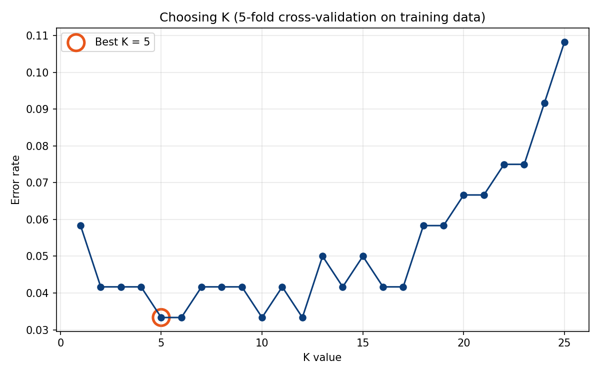
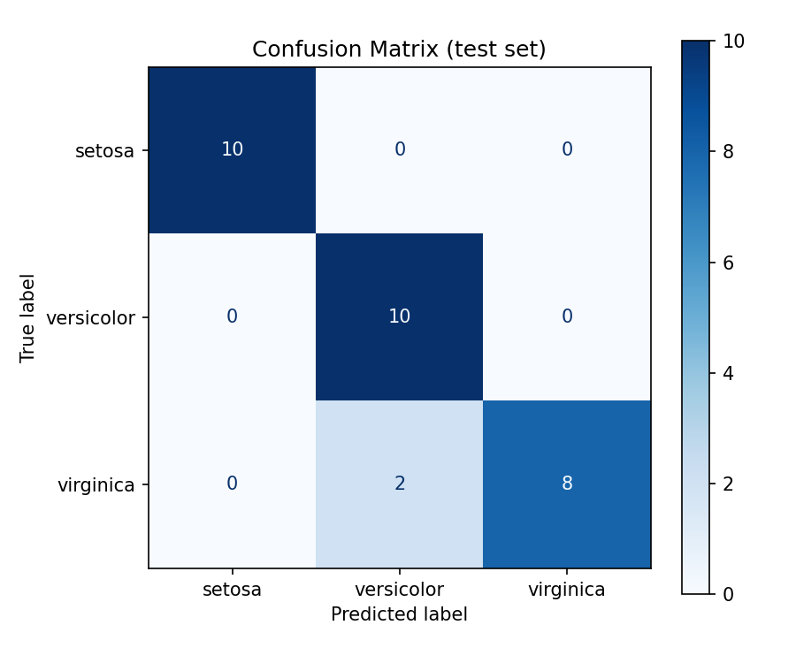

# 🌸 Data Classification Using AI

**DecodeLabs AI Internship – Project 2 (Batch 2026)**

A supervised-learning pipeline that classifies iris flowers into 3 species using the **K-Nearest Neighbors (KNN)** algorithm and scikit-learn.

## ✨ What it does (IPO framework)

| Stage | Steps |
|-------|-------|
| **Input** | Load the Iris benchmark dataset (150 samples, 4 features, 3 balanced classes) and print a summary |
| **Process** | Shuffled 80/20 train-test split → `StandardScaler` (fit on training data only) → choose K with 5-fold cross-validation → train KNN |
| **Output** | Accuracy, confusion matrix, precision / recall / **F1 score**, saved plots |

Bonus: compares KNN against Decision Tree, Logistic Regression and Random Forest, and can classify a flower you type in.

## 🚀 How to run

1. Install Python 3.9+ and open this folder in VS Code.
2. Install the libraries (one time):
   ```bash
   pip install -r requirements.txt
   ```
3. Run the pipeline (or press **F5** on `classifier.py`):
   ```bash
   python classifier.py
   ```
   Other options:
   ```bash
   python classifier.py --show      # also open the plot windows
   python classifier.py --predict   # then classify your own flower
   ```
4. Run the tests:
   ```bash
   python -m unittest discover tests
   ```

## 📊 Sample results (random_state = 42)

- Training samples: 120 | Test samples: 30 (stratified, so 10 per class)
- Best K from cross-validation: **5**
- Test accuracy: **93.3%** | Macro F1: **0.933**

```
Confusion matrix (rows = actual, columns = predicted)
              setosa  versicolor  virginica
setosa          10         0          0
versicolor       0        10          0
virginica        0         2          8
```

Setosa is classified perfectly. The only mistakes are virginica flowers predicted as versicolor, the two species whose measurements overlap.




## 🧠 Key concepts

- **Feature scaling**: KNN uses distances, so every feature must be on the same scale. The scaler is fitted on training data only, which avoids **data leakage**.
- **Shuffle + stratify**: removes order bias and keeps class proportions equal in train and test sets.
- **Choosing K**: K=1 overfits (noise), a very large K underfits. Cross-validation on the training set finds the sweet spot.
- **Why not just accuracy?** On imbalanced data accuracy can mislead, so we also report the confusion matrix and F1 score (the harmonic mean of precision and recall).

## 📁 Project structure

```
Project-2-Data-Classification/
├── classifier.py        # main pipeline
├── tests/               # unit tests
├── outputs/             # generated plots
├── requirements.txt
├── README.md
├── LICENSE
└── .gitignore
```

## 🔮 Next step

From tabular data to computer vision: deep learning and CNNs.
