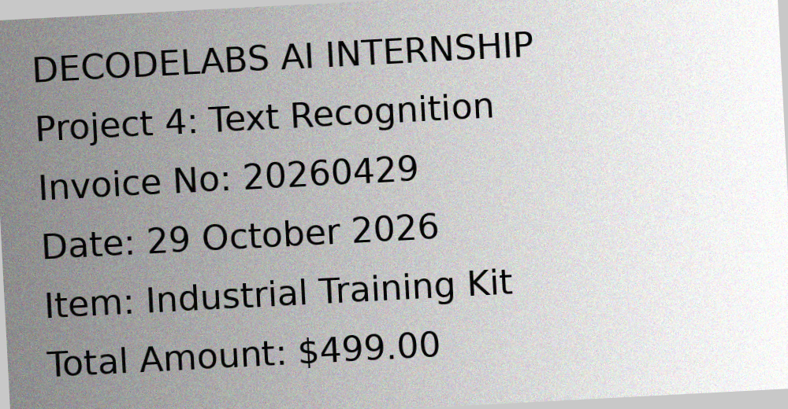
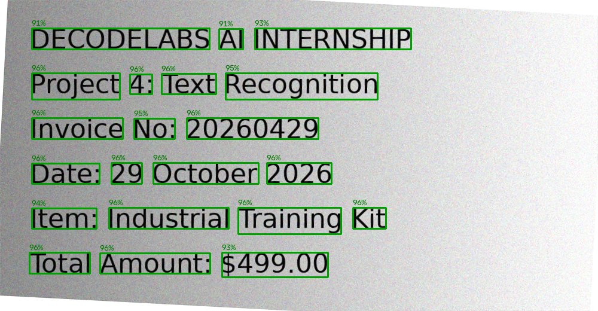

# 👁️ Image & Text Recognition (Basic): OCR Pipeline

**DecodeLabs AI Internship – Project 4 (Optional Mastery Phase, Batch 2026)**

A text-recognition pipeline built with **pytesseract** (Google's Tesseract OCR engine) and **OpenCV**. It takes a raw, noisy, tilted image, cleans it up, reads the text, and keeps only words the model is at least **80% confident** about. No model is trained: a pre-trained engine is plugged into a workflow (transfer learning in practice).

## 🧱 Architecture (IPO model)

| Stage | What happens |
|-------|--------------|
| **Input** | Load the image as a 3D array (height × width × 3 colour channels, values 0-255) |
| **Process** | Grayscale → Gaussian blur → adaptive threshold → deskew → OCR (`pytesseract`) → 80% confidence gate |
| **Output** | Recognised text, per-word confidence, annotated image with labelled boxes |

### Pre-processing steps
1. **Grayscale**: collapses the 3 colour channels into 1 intensity channel
2. **Gaussian blur**: removes sensor noise
3. **Adaptive threshold**: forces every pixel to pure black or white, adapting to uneven lighting and shadows
4. **Deskew**: measures the tilt and rotates the text back to a horizontal baseline

### The 80% confidence gate
```python
if confidence >= 0.80:
    keep_word_and_draw_box()
else:
    drop_word()
```

## ✅ Gatekeeper validations
Every run prints the four milestone checks:

1. **Library integration**: `pytesseract` + the Tesseract engine run without errors
2. **Pre-processing integrity**: grayscale + adaptive threshold executed, output is pure black/white
3. **Accuracy benchmark**: mean confidence of the final output is ≥ 80%
4. **Visual confirmation**: legible recognised text and an annotated image with labelled boxes

## 🛠️ Setup

### 1. Install the Tesseract engine (one time)
`pytesseract` is only a wrapper, so the engine must be installed separately.

- **Windows:** download the installer from https://github.com/UB-Mannheim/tesseract/wiki and install it to the **default folder**. Then close and reopen VS Code. The program finds it automatically. (If you installed elsewhere, set the environment variable `TESSERACT_CMD` to the full path of `tesseract.exe`.)
- **Ubuntu/Debian:** `sudo apt install tesseract-ocr`
- **macOS:** `brew install tesseract`

### 2. Install the Python libraries
```bash
pip install -r requirements.txt
```

## 🚀 How to run

```bash
python ocr_pipeline.py                                    # default noisy + tilted sample
python ocr_pipeline.py --image sample_images/sample_clean.png
python ocr_pipeline.py --image my_photo.jpg --psm 6       # your own image
python ocr_pipeline.py --compare                          # raw image vs pre-processed
```

| Option | Meaning |
|--------|---------|
| `--image` | path to any image (png, jpg, ...) |
| `--psm` | page layout: `3` automatic, `6` single block, `7` single line, `11` sparse text |
| `--threshold` | confidence gate, default `0.80` |
| `--no-deskew` | skip rotation correction |
| `--compare` | show OCR on the raw image vs the cleaned image |

Run the tests:
```bash
python -m unittest discover tests
```

## 📊 Sample result (`sample_noisy.png`: shadow + noise + 3° tilt)

```
Deskew ................. -3.0 degrees corrected
Words detected : 21   Kept (>= 80%) : 21   Dropped : 0
Mean confidence: 95.2%

DECODELABS AI INTERNSHIP
Project 4: Text Recognition
Invoice No: 20260429
Date: 29 October 2026
Item: Industrial Training Kit
Total Amount: $499.00

[PASS] 1. Library integration
[PASS] 2. Pre-processing integrity
[PASS] 3. Accuracy benchmark: mean confidence 95.2% (minimum 80%)
[PASS] 4. Visual confirmation
```

Pre-processing raises mean confidence on this image from about **87.6% to 95%** compared with reading the raw image.

| Original | Result |
|----------|--------|
|  |  |

Green boxes passed the 80% gate and carry their confidence label. Any rejected word is drawn as a thin red box.

## 📁 Project structure
```
Project-4-Text-Recognition-OCR/
├── ocr_pipeline.py          # main pipeline
├── make_sample_images.py    # regenerates the sample images (optional)
├── sample_images/           # clean + noisy/tilted test images
├── outputs/                 # generated: every pre-processing stage + annotated result
├── tests/                   # 16 unit tests
├── requirements.txt
├── README.md
├── LICENSE
└── .gitignore
```

## ⚠️ Limitations
- Tesseract reads printed text well, but handwriting, tiny fonts and very low-resolution photos give low confidence, so the gate drops those words.
- Heavy perspective distortion (a photo taken at an angle) is not corrected, only in-plane tilt.

## 🔮 Next step
**Path 2: object detection** with OpenCV's `cv2.dnn` and MobileNet-SSD (bounding boxes + class labels), then deep learning and CNNs.
